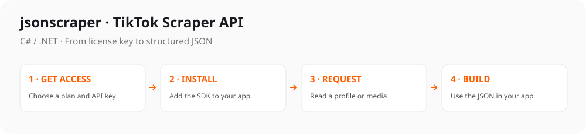

# TikTok Scraper API for C# / .NET

[](https://github.com/jsonscraper/tiktok-api-dotnet/tags)
[](#quick-start)
[](https://github.com/jsonscraper/tiktok-api-dotnet/commits)
[](LICENSE)
[](https://www.postman.com/evelode/workspace/evelode/collection/24862082-d886cc87-4267-4e0c-b57a-2d083add50ad)

A small, configurable client with named methods and ready-to-run examples. Supports **54 TikTok Scraper API methods**.

**Package:** `JsonScraper.TikTokApi` · **[Methods](#main-methods)** · **[Examples](#ready-to-run-examples)** · **[Documentation](docs/guide.md)**



## Quick start

**1. Get your key** from the [TikTok API product page](https://jsonscraper.com/services/tiktok-scraper-api?utm_source=github&utm_medium=sdk&utm_campaign=tiktok-api-dotnet&utm_content=readme) and set it on your server:

```sh
export JSONSCRAPER_TIKTOK_LICENSE_KEY='your-license-key'
```

**2. Install the package:**

```sh
git clone https://github.com/jsonscraper/tiktok-api-dotnet.git
cd tiktok-api-dotnet
dotnet pack -c Release -o ./artifacts
# In your application, use this local package folder:
dotnet add package JsonScraper.TikTokApi --version 0.1.0 --source /absolute/path/to/tiktok-api-dotnet/artifacts
```

**3. Make a request:**

```csharp
using JsonScraper.TikTokApi;

using var client = new TikTok(Environment.GetEnvironmentVariable("JSONSCRAPER_TIKTOK_LICENSE_KEY")!);
using var response = await client.JsonAsync("/getUserInfo", new Dictionary<string, object?> { ["query"]="therock", ["cache_timeout"]=60 });
if (response.RootElement.GetProperty("status").GetString() != "ok") throw new Exception("API application error");
Console.WriteLine(response.RootElement.GetProperty("tiktok"));
```

The API payload is in `tiktok`. Live calls require a valid API license and may consume quota. [Response examples and status handling](docs/responses.md).

## Main methods

54 methods are available. Common starting points:

| What you need | Method |
| --- | --- |
| Read a profile | `GetUserInfoAsync()` |
| Read a video | `GetVideoByIdAsync()` |
| Get a video download URL | `GetNoWatermarkUrlAsync()` |
| Read comments | `GetCommentsByIdAsync()` |
| Search videos | `SearchVideoAsync()` |
| List profile videos | `GetUserFeedAsync()` |

[All methods and parameters →](docs/endpoints.md)

## Ready-to-run examples

- [Read a profile](examples/endpoints/get_user_info/Program.cs).
- [Read a video](examples/endpoints/get_video_by_id/Program.cs).
- [Read comments](examples/endpoints/get_comments_by_id/Program.cs).
- [Search videos](examples/endpoints/search_video/Program.cs).
- [List profile videos](examples/endpoints/get_user_feed/Program.cs).

Each example includes command-line parameters, key setup, timeouts, error handling and response output. Run it with `--help` first; this makes no API request.

**[Browse all 54 complete examples](examples/README.md)** · **[Full method and parameter reference](docs/endpoints.md)**

## Configuration

Requests use a 30-second timeout by default. Configure caching and retries to fit your application's request budget. Keys are read from your server environment; redirects are disabled.

[Configuration options, HTTP errors, caching and pagination](docs/configuration.md) · [Full integration guide](docs/guide.md)

## Use with ChatGPT and Codex

Prefer an assistant connection? Use the separate [TikTok MCP server](https://jsonscraper.com/mcp/tiktok?utm_source=github&utm_medium=sdk&utm_campaign=tiktok-api-dotnet&utm_content=mcp). It accepts the same product API license and uses the normal API quota. [MCP source and setup](https://github.com/jsonscraper/tiktok-mcp-server).

## Access, pricing and support

The SDK source is **MIT-licensed**. Hosted API access requires a separate TikTok license. Check [current plans and get access](https://jsonscraper.com/services/tiktok-scraper-api?utm_source=github&utm_medium=sdk&utm_campaign=tiktok-api-dotnet&utm_content=readme).

[Service support](https://jsonscraper.com/contacts?utm_source=github&utm_medium=sdk&utm_campaign=tiktok-api-dotnet&utm_content=support) · [SDK issues](https://github.com/jsonscraper/tiktok-api-dotnet/issues) · [Changelog](CHANGELOG.md) · [MIT license](LICENSE)

## Development

```sh
python3 tests/contract.py
```

Tests use a local/mock server and require no API key. A [GitHub Actions template](docs/github-actions.yml) is available for optional automation.

The SDK has no installation or usage telemetry. README links use campaign parameters for website referral analytics. jsonscraper is independent and is not affiliated with TikTok.
